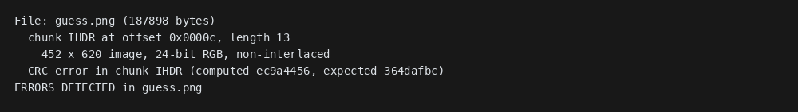
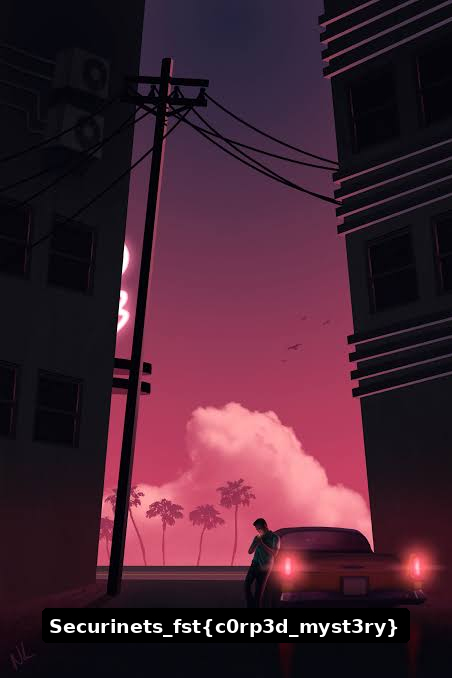

# Corrupted Truth

Author: Incendio

---

### Challenge Description
>
> A photograph of a quiet street has been recovered, but something about its dimensions seems wrong. The image is cut off, and the truth is nowhere to be seen.
>
> The file may be damaged, or someone may have changed its header. Inspect the PNG carefully, restore what is missing, and uncover the message hidden beyond the visible image.
>

The challenge provides one file:

- **corrupted_truth.png** — a PNG that appears to be cut off before the full image is shown, more than that there was a hint in the name... **Corrupted truth** means that something was not right, and most of the time these corruptions come from the header, but the magic headers are correct, best proof of this that the image opens normally. 
Since the the PNG appears to be cut off, it certainly is a corruption in the **Height** header field. 


---

### Step 1: Inspect the PNG Header

PNG stores its width and height in the `IHDR` chunk. The height is a four-byte big-endian integer at Hex byte offset 0x14. The file declares a height of 570 pixels, even though the compressed image data contains more rows.

```text
Offset 0x00: 89 50 4E 47 0D 0A 1A 0A  PNG signature
Offset 0x08: 00 00 00 0D              IHDR length (13)
Offset 0x0C: 49 48 44 52              IHDR chunk type
Offset 0x10: 00 00 01 C4              Width: 452
Offset 0x14: 00 00 02 3A              Height: 570
Offset 0x1D: 36 4D AF BC              IHDR CRC
```

---

### Step 2: Recover the Full Height — Three Ways

Each method below starts from the original `corrupted_truth.png`.

---

#### Option 1: Guess Heights Manually

As we all know this is the png header structure 

	Offset
	00: 89 50 4E 47 0D 0A 1A 0A    ← PNG signature
	08: 00 00 00 0D                ← IHDR length = 13
	0C: 49 48 44 52                ← "IHDR"
	10: WW WW WW WW                ← width (4 bytes, big-endian)
	14: HH HH HH HH                ← height (4 bytes, big-endian)
	18: 08                         ← bit depth
	19: 02                         ← color type (RGB)
	1A: 00                         ← compression
	1B: 00                         ← filter
	1C: 00                         ← interlace
	1D: CC CC CC CC                ← IHDR CRC

This is the hands-on approach. Increase the IHDR height in small steps, recalculate its CRC after each edit, validate the candidate with `pngcheck`, and open it to see whether more of the image or flag appears. For example, try 620 pixels first. The IHDR height is a four-byte big-endian number at offset `0x14`; its CRC is at `0x1D`.

`pngcheck` checks whether the CRC is valid and it calculates a replacement CRC. Example of the output

Change the four bytes at `0x14` from `00 00 02 3A` (570) to `00 00 02 6C` (620), and save a copy as `guess.png`. Then run:

```bash
pngcheck -v guess.png
```

`pngcheck` reports the checksum calculated from the edited IHDR and the old checksum stored in the file:

```text
452 x 620 image, 24-bit RGB, non-interlaced
CRC error in chunk IHDR (computed ec9a4456, expected 364dafbc)
ERRORS DETECTED in guess.png
```



The computed CRC `ec9a4456` is the replacement value. Write its big-endian bytes `EC 9A 44 56` at offset `0x1D` (the IHDR CRC), then check again:

```bash
pngcheck -v guess.png
```

```text
452 x 620 image, 24-bit RGB, non-interlaced
No errors detected in guess.png
```

Open `guess.png` and inspect the newly visible rows. Keep trying larger heights, updating the CRC each time, until the flag appears. This works by trial and inspection, but requires repeated guesses. The screenshots show the checksum error and the height calculator output used in the next option.

---

#### Option 2: Calculate the Height from IDAT Rows (Fully automated)

PNG stores compressed scanlines in its IDAT chunks. This image is 8-bit RGB and non-interlaced, so each scanline contains `452 × 3` pixel bytes and one filter byte: 1,357 bytes per row. Concatenate and decompress the IDAT chunks, then divide the decompressed length by 1,357:

```text
Decompressed IDAT size: 920046 bytes
Bytes per scanline: 1357
Calculated height: 678
```

The script below performs that calculation, updates IHDR and its CRC, and writes `recovered.png`:

```python
import struct
import zlib

path = "corrupted_truth.png"
data = bytearray(open(path, "rb").read())
width = struct.unpack(">I", data[16:20])[0]

# Collect all IDAT chunk data.
pos = 8
compressed = bytearray()
while pos < len(data):
    length = struct.unpack(">I", data[pos:pos + 4])[0]
    kind = data[pos + 4:pos + 8]
    chunk_data = data[pos + 8:pos + 8 + length]
    if kind == b"IDAT":
        compressed.extend(chunk_data)
    pos += 12 + length

raw = zlib.decompress(compressed)
height = len(raw) // (width * 3 + 1)
assert len(raw) == height * (width * 3 + 1)

data[20:24] = struct.pack(">I", height)
data[29:33] = struct.pack(">I", zlib.crc32(data[12:29]) & 0xffffffff)
open("recovered.png", "wb").write(data)
print(f"Restored image: {width} x {height}")
```

Output:

```text
Restored image: 452 x 678
```

---

### Step 3: Read the Recovered Image

Open `recovered.png`. The full-height image reveals the flag:



`Securinets_fst{c0rp3d_myst3ry}`
